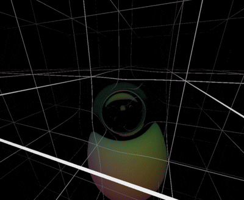

# Non Euclidean Raymarcher

<p align="center">
  
</p>

A GPU ray marcher written in [Taichi](https://www.taichi-lang.org/) that renders 3-manifolds embedded in $\mathbb{R}^4$.

## The math

Here, the space is described by a parametrization $f : \mathbb{R}^3 \to \mathbb{R}^4$ that maps coordinates $(u, v, w)$ to a point in $\mathbb{R}^4$. The demo scene above is a height field of two gaussian bumps, described by the following equation:

$$f(u,v,w) = \big(u,\ v,\ w,\ 5e^{-0.1(u^2+v^2+w^2)} + 2.5e^{-0.4((u-5)^2+(v-3)^2+(w+2)^2)}\big)$$

The tangent vectors ($r_u$, $r_v$, $r_w$) at a point are the partial derivatives of $f$. Stacked as rows, they form the $3 \times 4$ Jacobian $J$. Then, the metric tensor is derrived as $g = J J^T$, where any $g_{ij} = r_i \cdot r_j$. Note that contrary to constant Euclidean lengths, a coordinate vector $a$ has length $\sqrt{a^T g\, a}$.

### Stepping a ray

Each ray has a position $p$ and a velocity $v$, and stepping a ray is a relatively simple process. First, we convert the velocity to a vector in $\mathbb{R}^4$, so $V = J^T v = v^u r_u + v^v r_v + v^w r_w$. Then, we move forward in a straight line: $P' = f(p) + V\,\Delta t$. However, this new point is slightly off the manifold. As such, we we reproject back onto the manifold by finding the coordinates $p'$ whose image is closest to $P'$, minimizing $\lVert f(p') - P' \rVert^2$ via [Gauss-Newton iteration](https://en.wikipedia.org/wiki/Gauss%E2%80%93Newton_algorithm).

$$
p \leftarrow p - (J J^T)^{-1} J \big(f(p) - P'\big) = p - g^{-1} J\, r
$$

Finally, we project $V$ onto the tangent space at $p'$ and convert it back into coordinates. Formally, $v'^i = g^{ij}\, (r_j \cdot V)$.

### Ray marching

Rays are marched with SDFs. At each step, the ray finds the nearest object distance $d$. Then, it advances by $\Delta t = \min(0.8d,\ 0.4)$, and a hit is detected when $d < 0.01$. 

Spheres are defined in $\mathbb{R}^4$. Its center is $f(c)$ with its SDF the Euclidean distance $\lVert f(p) - f(c) \rVert - R$. Importantly, this is not the true geodesic distance, though it is good enough for small steps. Normals are the SDF's gradient $\nabla d$. Since it is a covector, we raise it with the inverse metric to get the real tangent direction $n^i = g^{ij} \partial_j d$. The grid is simply an SDF of spaced lines.

## Running

```sh
pip install taichi numpy pyyaml pillow
python main.py
```

Settings are defined in `config.yaml`. Keybinds are as follows:

| Key | Action |
| --- | --- |
| `W` / `S` | forward / back |
| `A` / `D` | left / right |
| `Q` / `E` | down / up |
| arrow keys | look around |
| `Esc` | quit |
